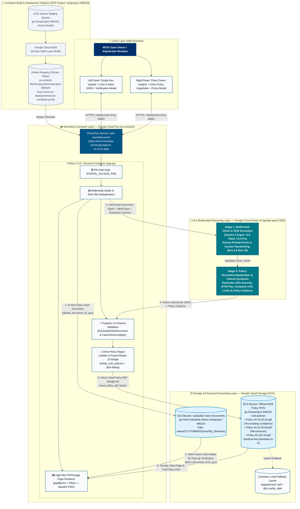
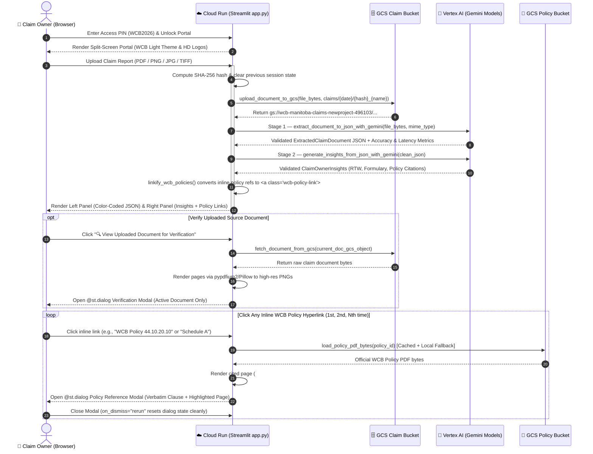

# WCB Manitoba Claim Intake & Insights Portal — Cloud Architecture

## 1. End-to-End Google Cloud Architecture Diagram

---

## 2. Runtime Execution & Pop-Up Verification Sequence

---

## 3. Deployed Google Cloud Resource Inventory

| Layer | GCP Service | Resource Name / Identifier | Region / Location | Role in Architecture |
| :--- | :--- | :--- | :--- | :--- |
| **Compute & Web UI** | **Cloud Run** | `wcb-manitoba-portal` (`wcb-manitoba-portal-00009-knm`) | `us-central1` | Hosts the containerized Python 3.12 + Streamlit portal at `https://wcb-manitoba-portal-gpyorjpwra-uc.a.run.app` |
| **AI Extraction & Reasoning** | **Vertex AI (Gemini API)** | `google-genai` SDK (`gemini-4-argon`, `gemini-3.8-flash`, `gemini-2.5-pro`, `gemini-2.5-flash`) | `global` / `us-central1` | Performs Stage 1 Multimodal OCR/JSON extraction and Stage 2 policy-grounded Claim Owner Insights synthesis |
| **Claim Document Storage** | **Cloud Storage (GCS)** | `gs://wcb-manitoba-claims-newproject-496103` | `us-central1` | Archives every uploaded workplace injury report (`claims/{YYYYMMDD}/{sha256}_{filename}`) and serves bytes to the document verification modal |
| **Policy Document Storage** | **Cloud Storage (GCS)** | `gs://newproject-496103-wcb-policies` | `us-central1` | Stores official WCB Manitoba PDFs (`Policy 44.10.20.10.pdf`, `Policy 44.10.20.60.pdf`, `Policy 44.120.10.pdf`) under `policies/` for the citation pop-up viewer |
| **Container Registry** | **Artifact Registry** | `us-central1-docker.pkg.dev/newproject-496103/mcp-cloud-run-deployments/wcb-manitoba-portal` | `us-central1` | Stores versioned and `:latest` Docker container images built by Cloud Build |
| **CI/CD Build Pipeline** | **Cloud Build & GCS** | `gs://newproject-496103-source-bucket` | `us-central1` | Stages application source archives and executes automated container builds (`Dockerfile`) |
