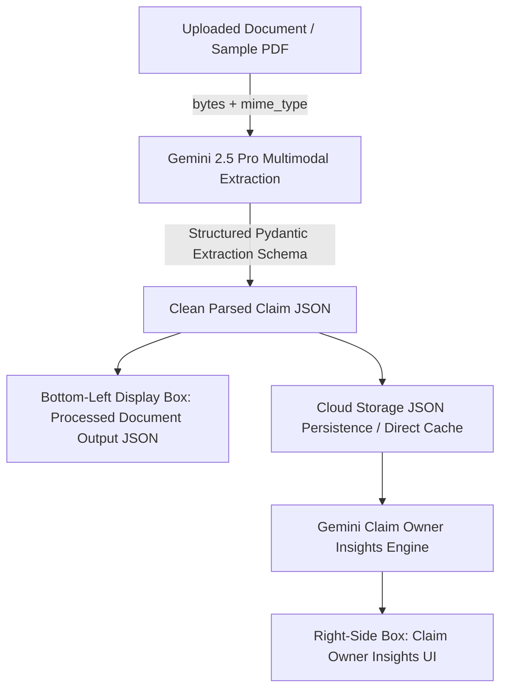

# Replace Document AI with Gemini Multimodal Extraction for WCB Claim Documents

## Problem & Background
The WCB Manitoba Claim Intake & Insights Portal currently parses uploaded claim documents (such as WCB Form 4036 Doctor's First Reports) using Google Cloud Document AI (`google-cloud-documentai`). The output of Document AI is then formatted into a JSON structure, persisted/retrieved, and passed to Gemini to generate Claim Owner insights.

The user has requested an architectural change:
1. Replace Document AI with Gemini (using the frontier model `gemini-2.5-pro` verified on Vertex AI in this GCP project) to extract all document fields directly from multimodal inputs (PDF, PNG, JPG, TIFF).
2. Output a comprehensive, clean, and well-structured JSON document schema displayed in the bottom-left output box.
3. Feed this clean extracted JSON into the existing Claim Owner Insights generator on the right side.

---

## User Review Required

> [!IMPORTANT]
> **Model Selection**: On the active Google Cloud project (`newproject-496103` on Vertex AI `us-central1`), `gemini-2.5-pro` is verified and available for multimodal document processing and structured JSON generation. We will configure `gemini-2.5-pro` as the primary extraction model with `gemini-2.5-flash` available as a fast alternative.
>
> **Document AI Removal**: With Gemini handling document parsing directly, the dependency on Document AI (`DOCAI_LOCATION`, `DOCAI_PROCESSOR_ID`, and `google-cloud-documentai` client) is no longer required for document intake, simplifying the deployment architecture.

---

## Proposed Architectural Flow

---

## Proposed Changes

### Core Application (`app.py`)

#### [MODIFY] [`app.py`](file:///home/achinagrawal/wcb-manitoba/app.py)
1. **Define Clean Document Extraction Schema**:
   Create a comprehensive Pydantic model (`ClaimDocumentExtraction`) capturing:
   - `document_metadata`: File name, claim reference ID, processing timestamp, document type, form number (e.g. Form 4036).
   - `worker_information`: Name, PHIN, date of birth, phone number, address.
   - `employer_information`: Employer name, location/branch.
   - `incident_details`: Date and time of injury, mechanism of injury, injury narrative.
   - `clinical_assessment`: Primary ICD-10 diagnosis code and description, secondary diagnoses, objective clinical findings, affected anatomy/body parts.
   - `pre_existing_conditions`: Flag (`bool`), detailed findings, prior imaging references.
   - `return_to_work_capabilities`: Modified duties cleared (`bool`), duration, lifting restrictions, postural restrictions, sitting/standing tolerances.
   - `treatment_plan`: Prescribed medications (drug name, dose, frequency, PRN), therapies (physio/chiro), referrals.
   - `attending_physician`: Doctor name, CPSM license/registration, facility name, address/city.
   - `key_fields_summary`: Flat list of key extracted fields with normalized names and confidence/completeness scores for quick inspection.

2. **Implement `extract_document_with_gemini`**:
   - Accepts `file_bytes`, `mime_type`, `filename`.
   - Sends the document bytes (`types.Part.from_bytes(data=file_bytes, mime_type=mime_type)`) directly to Gemini (`gemini-2.5-pro`).
   - Uses `response_schema=ClaimDocumentExtraction` to enforce strict, clean JSON output without hallucinations or regex scraping.
   - Supports both Vertex AI (`vertexai=True`, `us-central1`) and direct Gemini API Key fallback.

3. **Refactor Pipeline Function `run_full_document_pipeline`**:
   - Replaces `parse_document_with_docai` with `extract_document_with_gemini`.
   - Formats the clean extracted JSON dictionary for display in the bottom-left card.
   - Feeds the clean JSON into `analyze_stored_json_with_gemini` to generate right-side Claim Owner Insights.

4. **Update Session State and UI labels**:
   - Rename session state keys (e.g. `docai_json_output` -> `extracted_json_output` with backward-compatibility alias).
   - Update UI headers and badges: "Processed Document Output (Gemini 2.5 Pro JSON)".
   - Add clean formatting and stats (e.g. field count, model badge).

### Dependencies & Configuration

#### [MODIFY] [`Dockerfile`](file:///home/achinagrawal/wcb-manitoba/Dockerfile)
- Update environment variables to remove obsolete Document AI processor IDs and configure Gemini model settings:
  - `GEMINI_EXTRACTION_MODEL="gemini-2.5-pro"`
  - `GEMINI_INSIGHTS_MODEL="gemini-2.5-pro"`
  - `GCP_REGION="us-central1"`

#### [MODIFY] [`requirements.txt`](file:///home/achinagrawal/wcb-manitoba/requirements.txt)
- Keep `google-genai>=2.25.0`, `streamlit>=1.42.0`, `pydantic>=2.10.0`, `google-cloud-storage>=2.18.0`.
- Mark `google-cloud-documentai` as optional or remove if no longer needed.

---

## Verification Plan

### Automated / Headless Verification
1. **Syntax and Import Checks**:
   - Run `.venv/bin/python -m py_compile app.py` to ensure clean syntax.
2. **End-to-End Extraction Test**:
   - Execute a headless Python test script passing `build_sample_form4036_pdf_bytes()` through `extract_document_with_gemini()`:
     - Verify valid JSON structure according to `ClaimDocumentExtraction`.
     - Verify correct extraction of worker name, PHIN, ICD-10 code (`M54.5`), lifting restrictions (10 lbs), and medications (Naproxen, Acetaminophen).
3. **End-to-End Insights Pipeline Test**:
   - Verify that the extracted JSON passes into `analyze_stored_json_with_gemini()` and yields complete `ClaimOwnerInsights`.
4. **Streamlit App Launch Check**:
   - Run `streamlit run app.py --server.headless=true` briefly to verify error-free initialization.

### Manual Verification
- Review the bottom-left JSON display box to confirm clean typography, formatting, and full JSON payload visibility.
- Review the right-side Claim Owner Insights cards to verify all metrics (Worker KPI, Diagnosis KPI, Adjudication status, RTW posture, executive summary, policy 44.10.20.10 alert, medications) render consistently.
